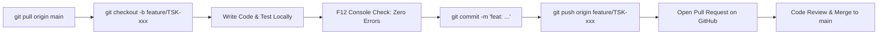

# Contributing to the 1st Petaling Jaya Boys' Brigade Web Portal

Welcome to the **1st PJ Boys' Brigade Web Portal** development team! ⚓💻

This guide outlines our team workflow, coding standards, Git safety rules, and design tokens to keep our codebase fast, modular, and regression-free.

---

## 1. Core Principles

1. **Duties First**: Your academic and NCO company duties always take top priority over coding.
2. **Never Break `main`**: All code on the `main` branch must run without errors in the browser.
3. **No Direct Pushes to `main`**: All changes must go through a dedicated feature branch and Pull Request (PR).
4. **Test Before Pushing**: Always check DevTools (press `F12` in Chrome/Edge) for red console errors before submitting code.

---

## 2. Local Setup

### Prerequisites
- [Git](https://git-scm.com/) (or [GitHub Desktop](https://desktop.github.com/))
- [Visual Studio Code](https://code.visualstudio.com/)
- Recommended VS Code Extensions:
  - **Live Server** (by Ritwick Dey) — for 1-click local browser preview with live reload.
  - **Prettier** — for consistent formatting.

### Getting the Code
```bash
# 1. Clone the repository
git clone https://github.com/1st-Petaling-Jaya-Boys-Brigade/1stPetalingJayaBoys-Brigade-.git

# 2. Enter directory
cd 1stPetalingJayaBoys-Brigade-

# 3. Pull latest updates
git pull origin main
```

### Running Locally
Because we use modern ES module architecture, opening `index.html` via `file:///` can cause browser security restrictions. Always serve it through a local HTTP server:

- **Option A (VS Code)**: Right-click `index.html` -> Click **"Open with Live Server"**.
- **Option B (Python)**: Run `python -m http.server 8000` in terminal and visit `http://localhost:8000`.
- **Option C (Node.js)**: Run `npx serve .` and open the local URL shown.

---

## 3. Git Workflow & Safety Rules

To prevent 3 developers from colliding or creating merge conflicts, follow this step-by-step workflow for every task:



### Step-by-Step Instructions:

1. **Sync with Main**:
   ```bash
   git checkout main
   git pull origin main
   ```
2. **Create a Feature Branch**:
   Name your branch using your Task ID or Bug ID:
   ```bash
   git checkout -b feature/TSK-006B-uniform-grid
   # or for bug fixes:
   git checkout -b bugfix/BUG-004-uniform-preview
   ```
3. **Make Your Changes & Test**:
   - Open browser, test feature on desktop and mobile responsive mode (press `Ctrl + Shift + M`).
   - Open DevTools Console (`F12`) to verify there are zero red errors.
4. **Commit with Meaningful Messages**:
   Include the Task ID or Bug ID in your commit title:
   ```bash
   # Format: <type>: <description> (<TASK-ID>)
   git commit -m "feat: implement responsive uniform product card grid (TSK-006B)"
   git commit -m "fix: add missing uniform-products-preview container in form builder (BUG-004)"
   ```
5. **Push Your Branch to GitHub**:
   ```bash
   git push origin feature/TSK-006B-uniform-grid
   ```
6. **Open a Pull Request**:
   - Go to the repository on GitHub.
   - Click **"Compare & pull request"**.
   - Fill out the PR summary (see template below) and request review from the **Lead Engineer**.

---

## 4. Team Ownership & Architecture Map

To eliminate merge conflicts, each developer owns dedicated domain files. **Avoid editing another engineer's files without checking with them first.**

```
1stPetalingJayaBoys-Brigade-/
├── index.html                  # Main application shell & view pages
├── README.md                   # Project overview & database documentation
├── CONTRIBUTING.md             # Developer guidelines & coding standards
├── assets/                     # Brand logos, icons, photos
├── css/                        # [Engineer 2 / Styling]
│   ├── variables.css           # Color tokens, fonts, root variables
│   ├── base.css                # Typography, reset, utility classes
│   ├── nav.css                 # Sticky navigation, side drawer
│   ├── components.css          # Cards, buttons, form inputs, pills
│   └── admin.css               # Admin console styling & data tables
└── js/
    ├── config.js               # [Lead Engineer] Global configs & API endpoints
    ├── api/
    │   ├── supabase.js         # [Lead Engineer] Supabase REST & Storage client
    │   └── sheets.js           # [Lead Engineer] Google Sheets sync webhook
    ├── core/
    │   ├── session.js          # [Lead Engineer] Session storage manager
    │   └── ui.js               # [Engineer 2] Toast notifications & modals
    └── modules/
        ├── member.js           # [Lead Engineer] Member hub, auth & profile
        ├── orders.js           # [Engineer 2] Uniform catalog, cart & checkout
        ├── forms.js            # [Engineer 2] Custom form builder
        ├── tasks.js            # [Engineer 2] NCO tasks board & kanban
        ├── attendance.js       # [Lead Engineer] Band & Parade attendance scoring
        ├── badges.js           # [Engineer 3] Awards & President's badge tracker
        ├── announcements.js    # [Engineer 3] Company news feed & reactions
        ├── gallery.js          # [Engineer 3] Photo gallery & lightbox
        └── admin.js            # [Lead Engineer] Master back-office controller
```

---

## 5. JavaScript Coding Standards

1. **Global Scope & HTML Handlers**:
   - Because our HTML uses inline handlers (e.g. `onclick="switchTab('order')"`), all module functions that are invoked by buttons must be attached to `window`:
   ```javascript
   function renderOrderItems() { /* ... */ }
   
   // Always attach to window for HTML onclick compatibility:
   window.renderOrderItems = renderOrderItems;
   ```
2. **Defensive DOM Lookups**:
   - Never assume an element exists. Always use safe lookups to avoid `TypeError: Cannot read properties of null`:
   ```javascript
   // ❌ Bad (throws error if element is missing):
   var val = document.getElementById('my-input').value;

   // ✅ Good (gracefully falls back):
   var val = (document.getElementById('my-input') || {}).value || '';
   ```
3. **Global Constants & Variables**:
   - Do NOT declare top-level `const` in non-module scripts if that variable name might exist elsewhere. Use `var` or attach to `window` to avoid `SyntaxError: Identifier has already been declared`.
4. **Data Privacy First**:
   - Never collect, store, or display Malaysian IC / MyKad numbers or private identification data. All member features use Email, Full Name, Age, and BB Section.

---

## 6. CSS Tokens & UI Design System

Always use the shared CSS variables from [`css/variables.css`](css/variables.css) to maintain company branding:

| Token Name | Hex Value | Usage |
| :--- | :--- | :--- |
| `--navy` | `#0a1628` | Main dark background |
| `--navy2` | `#111e35` | Secondary card background |
| `--blue` | `#1a3a6e` | Highlight / active state |
| `--accent` | `#c8961e` | BB Gold accent / links |
| `--gold` | `#e8b830` | Headings & active tabs |
| `--light` | `#f4f6fa` | Light surfaces / cards |
| `--white` | `#ffffff` | Pure white text & icons |
| `--red` | `#c0392b` | Danger / cancel buttons |
| `--green` | `#1a7a3a` | Success badges & submit buttons |
| `--muted` | `#7a8599` | Subtitles and helper text |

### Standard HTML Component Classes:
- `.card`: White/light container card.
- `.dark-card`: Dark navy container card (`#111e35`).
- `.page-title`: Large gold heading (Oswald font).
- `.page-subtitle`: Secondary section header.
- `.submit-btn`: Primary button.
- `.submit-btn.gold`: Highlighted gold action button.
- `.form-input`: Standard text/email/password input.
- `.form-select`: Styled dropdown select.

---

## 7. Pull Request (PR) Template

When opening a Pull Request on GitHub, copy and paste this simple checklist into the description:

```markdown
### 📌 Task ID & Title
- **Task ID**: TSK-00xxx
- **Task Title**: [Title of your task]

### 📝 Summary of Changes
- Briefly explain what you added or changed (2–3 sentences).
- Bullet point 1
- Bullet point 2

### 🧪 Verification & Testing Checklist
- [ ] Tested in desktop browser (Chrome/Edge/Firefox).
- [ ] Tested in mobile responsive view (F12 device toggle).
- [ ] Opened F12 Console: Zero red error messages.
- [ ] Verified existing tabs and features still work properly.
```

---

*“Sure & Stedfast” — 1st Petaling Jaya Company, The Boys' Brigade in Malaysia*
